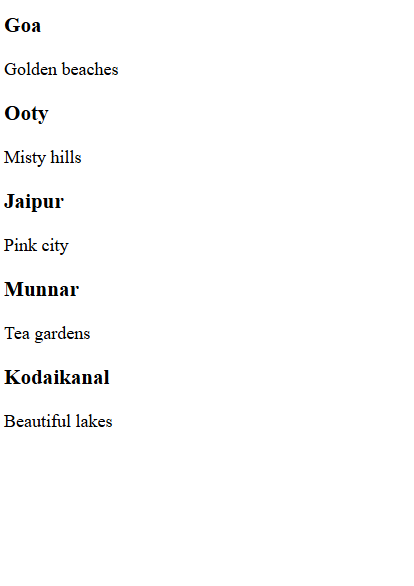
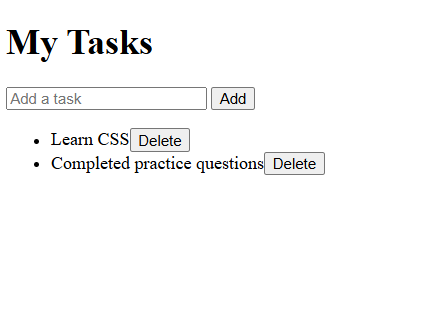

# JavaScript Mini Projects

A collection of beginner-friendly JavaScript mini projects built as part of my JavaScript learning journey. These projects helped me practice DOM manipulation, event handling, form validation, and browser localStorage.

## Projects

### 1. Dynamic Gallery Cards

**Features:**
- Creates gallery cards dynamically using JavaScript.
- Uses arrays and objects to store place information.
- Uses `forEach()` to loop through the array.
- Creates HTML elements using `createElement()`.
- Displays card information using `textContent`.

**Screenshot:**

### 2. Live Counter

**Features:**
- Increases the counter using the plus button.
- Decreases the counter using the minus button.
- Updates the counter dynamically.
- Changes the text color to red when the count is negative.
- Changes the text color back to black when the count is zero or positive.

**Screenshots:**

### 2. Live Counter

### 3. Registration Form Validation

**Features:**
- Validates name, email, phone number, and password.
- Checks name length.
- Validates email using regular expressions.
- Validates Indian 10-digit mobile numbers.
- Checks password length.
- Displays error messages for invalid inputs.
- Shows a success message after successful validation.

**Screenshots:**

### 4. To-Do List

**Features:**
- Adds new tasks.
- Marks tasks as completed.
- Deletes tasks.
- Uses event delegation to handle task clicks.
- Saves tasks using browser localStorage.
- Restores saved tasks after refreshing the page.

**Screenshots:**

### 5. Dark Mode

**Features:**
- Toggles between light mode and dark mode.
- Uses `classList.toggle()` to change the theme.
- Saves the selected theme using localStorage.
- Remembers the selected theme after refreshing the page.

**Screenshots:**

## Technologies Used

- HTML5
- CSS3
- JavaScript
- Git
- GitHub

## JavaScript Concepts Practiced

- Variables and functions
- Arrays and objects
- Array methods (`forEach()`)
- DOM selection and manipulation
- `createElement()` and `append()`
- Event handling
- Event delegation
- Form validation
- Regular expressions
- `classList`
- JSON (`JSON.parse()` and `JSON.stringify()`)
- Browser localStorage

## How to Run the Projects

1. Clone this repository:

   
   git clone https://github.com/srithulasika/mini-projects.git
  

2. Open the cloned repository in VS Code.

3. Navigate to any project folder.

4. Open its `index.html` file in your browser.

5. Explore and test the functionality.

## Author

**Sri Thulasika**

- GitHub: [srithulasika](https://github.com/srithulasika)
- Repository: [ Mini Projects](https://github.com/srithulasika/mini-projects)

Created as part of my JavaScript learning and practice journey.
